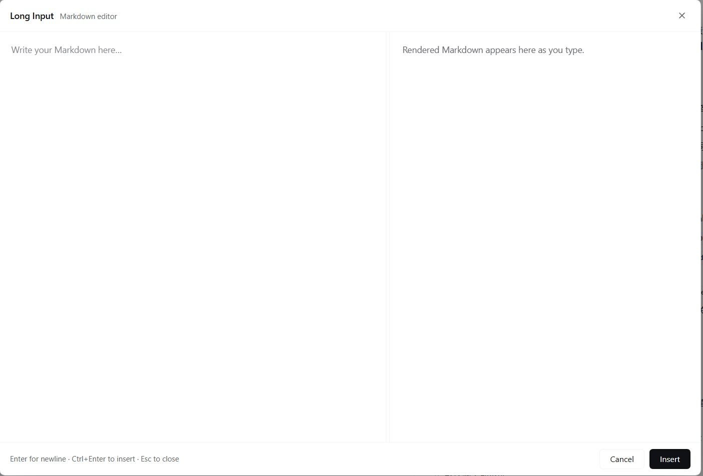
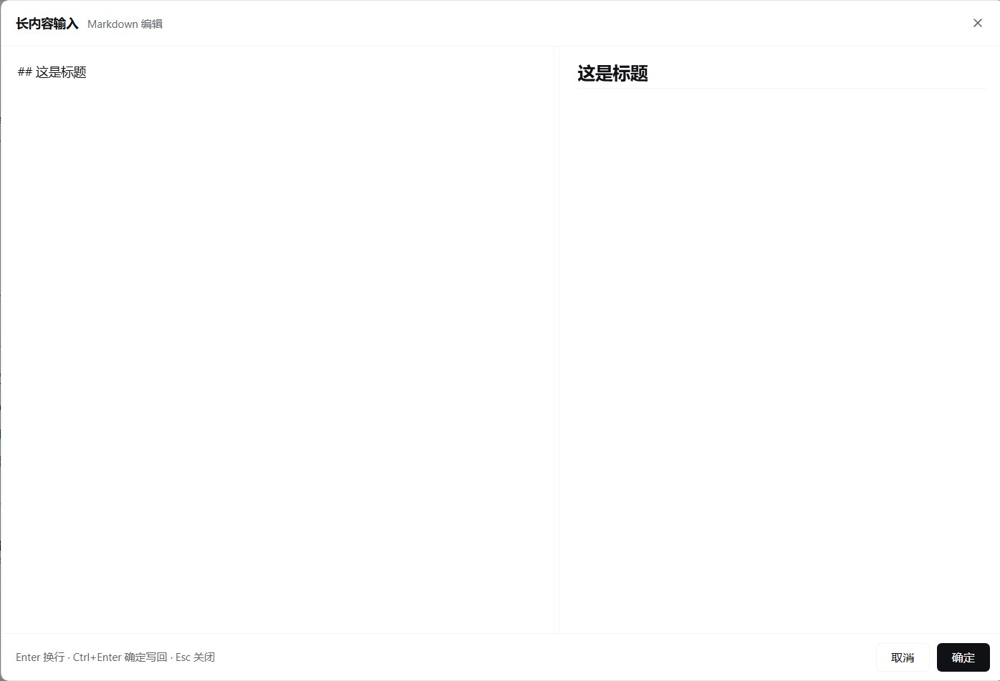

# dsh-long-input

**中文**：DeepSeek Harness Web 输入框的「长内容 Markdown 编辑弹窗」插件。点击输入框底部的「长内容输入」按钮，弹出左右分栏窗口——左边写 Markdown，右边实时预览，确认后一次写回输入框。

**English**: A long-form Markdown editor dialog for the DeepSeek Harness Web composer. A "Long Input" button in the composer toolbar opens a split-pane dialog — write Markdown on the left, preview it live on the right, then write the result back to the composer in one action.





---

## 功能 / Features

**中文**

- 输入框底部工具栏（权限/计划控件右侧）出现「长内容输入」按钮，按钮文字跟随界面语言（中文「长内容输入」/ 英文「Long Input」）。
- 打开弹窗时自动带入当前输入框的草稿，随后两侧独立编辑、互不同步。
- 左侧纯文本编辑，右侧实时渲染 Markdown（GFM、支持换行），渲染由内置 marked 完成。
- 中缝可拖动调整左右宽度（20%–80%），比例自动记住。
- 写回时保留原输入框里的指令（如 `/goal`）与 `@文件` 引用，它们作为固定前缀重新附加，不会被删除。
- 关闭窗口（X / 取消 / `Esc`）时询问「不写回」还是「写回」，可勾选「记住我的选择」；也能在插件设置页里预先设定，或恢复为每次询问。
- 跟随明暗主题与界面语言，无需额外配置。

**English**

- A "Long Input" button appears in the composer toolbar (to the right of the permission/plan controls); its label follows the UI locale (Long Input / 长内容输入).
- Opening the dialog imports the current draft from the composer; after that both sides edit independently, with no reverse syncing.
- Plain-text editing on the left, live Markdown rendering on the right (GitHub Flavored Markdown, line breaks honored), powered by a bundled copy of marked.
- Drag the divider to resize the two panes (20%–80%); the ratio is remembered.
- Writing back preserves slash commands (e.g. `/goal`) and `@file` references from the original draft — they are re-attached as a fixed prefix rather than dropped.
- Closing (X / Cancel / `Esc`) asks whether to discard or write back, with a "remember my choice" option; the same behavior can be preset in the plugin settings or reset to always ask.
- Follows light/dark theme and UI locale with no configuration.

---

## 快捷键 / Shortcuts

| 操作 / Action | 快捷键 / Keys |
| --- | --- |
| 换行 / New line | `Enter` |
| 写回输入框 / Write back to composer | `Ctrl+Enter` / `Cmd+Enter` |
| 关闭弹窗 / Close dialog | `Esc` |

---

## 安装 / Install

本插件已发布到 npm，包名 `dsh-long-input`。插件自带预构建产物，**安装后无需任何构建步骤**。
The package is published on npm as `dsh-long-input` and ships a prebuilt bundle — **no build step is required after install**.

### 从 npm 安装（推荐）/ From npm (recommended)

```sh
dsh plugin --profile web add dsh-long-input
```

桌面版（Desktop）请改用 desktop profile：
On Desktop, target the desktop profile instead:

```sh
dsh plugin --profile desktop add dsh-long-input
```

### 从 GitHub 安装 / From GitHub

```sh
dsh plugin --profile web add github:DingL0312/dsh-long-input-window
```

### 从本地目录安装 / From a local folder

```sh
dsh plugin --profile web add ./dsh_md_input_window
```

### 图形界面安装 / GUI

设置 → 插件 → 「+ 添加插件」→ 输入 `dsh-long-input` → 安装 → 重启 DeepSeek Harness。
Settings → Plugins → "+ Add plugin" → enter `dsh-long-input` → Install → restart DeepSeek Harness.

### 安装后 / After installing

重启 DSH（命令行下 `Ctrl+C` 后重新 `dsh web`，桌面版从应用菜单重启）并刷新浏览器页面，按钮即会出现在输入框底部工具栏。
Restart DSH (`Ctrl+C` then `dsh web` again, or restart the Desktop app) and refresh the browser — the button then appears in the composer toolbar.

---

## 更新与卸载 / Update & uninstall

```sh
dsh plugin --profile web add dsh-long-input@latest   # 更新到最新 / update to latest
dsh plugin --profile web remove dsh-long-input       # 卸载 / uninstall
```

---

## 设置 / Settings

设置 → 插件 → dsh-long-input：
Settings → Plugins → dsh-long-input:

- **关闭窗口时**：选择「退出窗口不写回」或「退出并写回」；两个都不选则每次关闭都询问。**恢复默认设置**会清空该选择并把分栏比例重置为 50%。
- **On close**: choose "Exit without writing back" or "Exit and write back"; select neither to be asked every time. **Restore defaults** clears the choice and resets the split ratio to 50%.

---

## 说明 / Notes

**中文**

- 写回是整体覆盖输入框草稿；指令与 `@引用` 会被保留并移到正文之前。
- 预览不对原始 HTML 做消毒，请勿粘贴不可信的第三方 HTML。
- 弹窗打开期间切换会话会自动关闭，避免写回错误的会话。
- 勾选「记住我的选择」后关闭不再询问；想恢复询问，在插件设置页取消选择或点「恢复默认设置」。
- 仅面向 Web 界面。

**English**

- Writing back replaces the whole composer draft; slash commands and `@` references are preserved and moved in front of the body text.
- The preview does not sanitize raw HTML — do not paste untrusted third-party HTML.
- Switching sessions while the dialog is open closes it, so content is never written to the wrong session.
- Once "remember my choice" is saved, closing no longer asks; unset it in the plugin settings (or use "Restore defaults") to ask again.
- Web UI only.

---

## License

MIT。`marked` 的版权与许可信息见 `THIRD_PARTY_NOTICES.md`。/ MIT. Copyright and license information for `marked` is in `THIRD_PARTY_NOTICES.md`.
